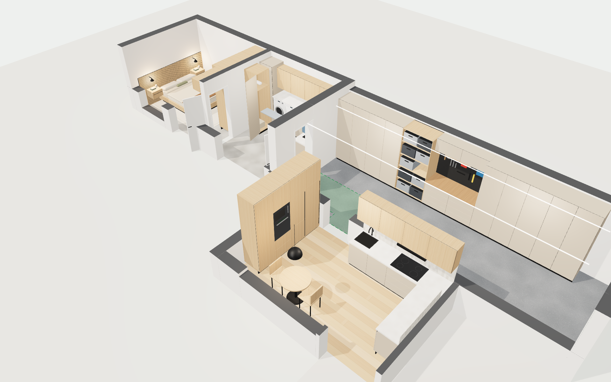
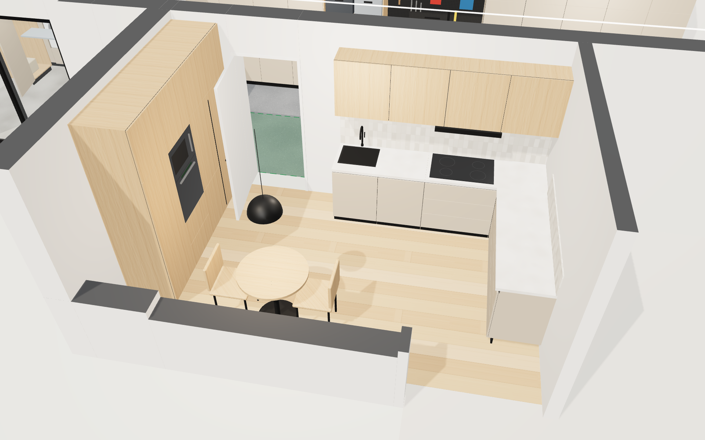
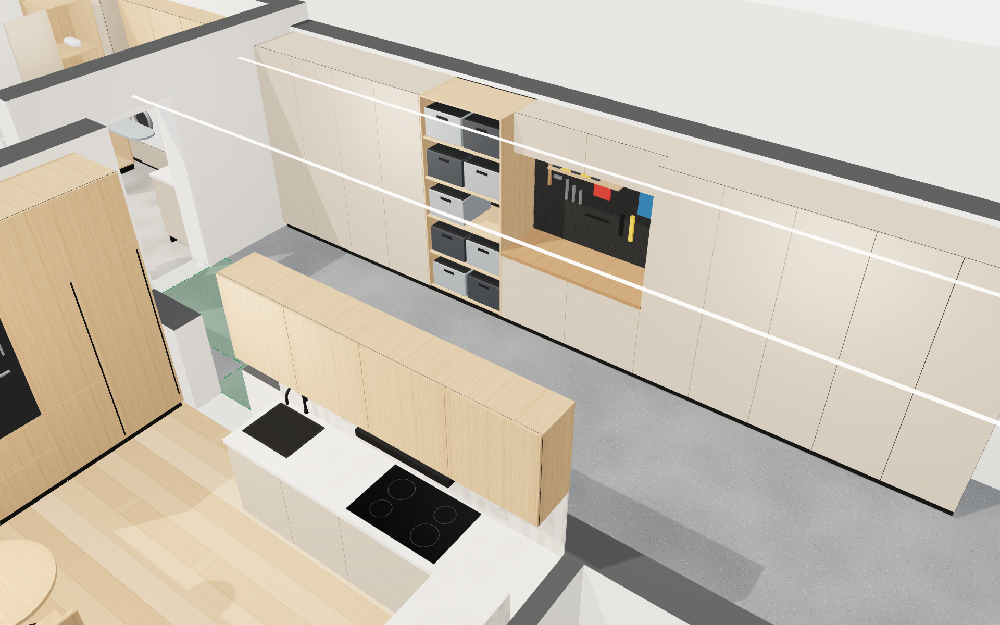
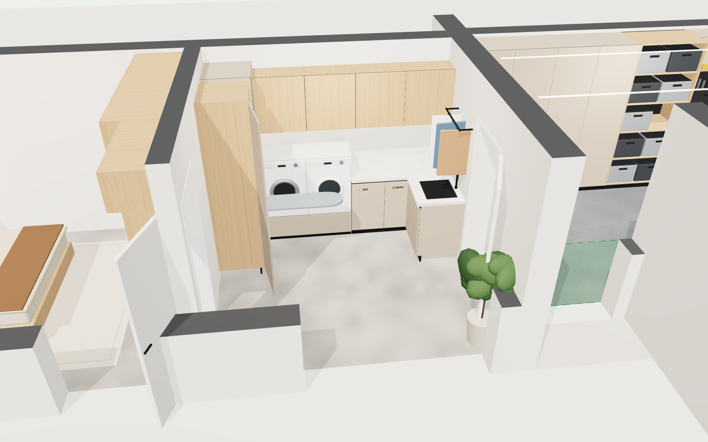
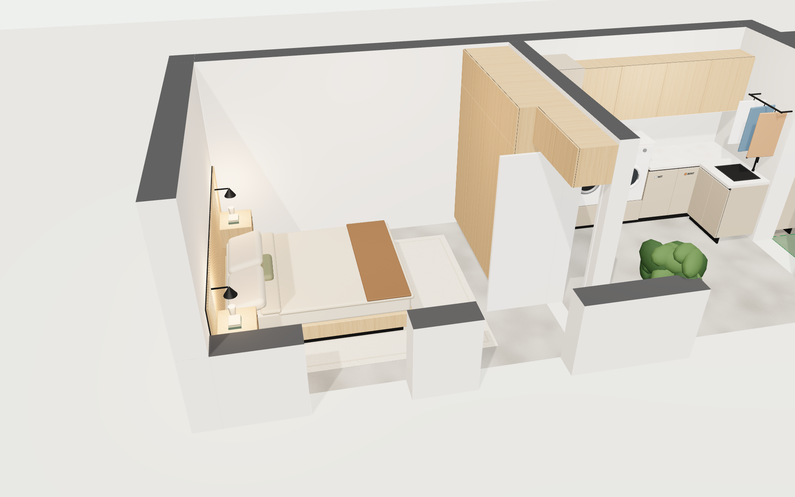

# Interieur-visualizer

A small, data-driven **3D interior design visualizer** built with [Three.js](https://threejs.org/).
A floor plan (rooms, walls, door and window openings) and the furniture and fixtures are described in one JSON file. The page renders it as an interactive 3D "dollhouse" in the browser. It is a static site: no build step and no server code. Three.js is vendored in `vendor/`.

**Live demo:** https://pvleest.github.io/interieur-visualizer/

The demo plan (`plans/vleugel.json`) is an interior design concept for a kitchen, a garage, and a new extension with a utility room (*bijkeuken*) and a bedroom. All dimensions are indicative.



| Keuken | Garage |
|---|---|
|  |  |
| **Bijkeuken** | **Slaapkamer** |
|  |  |

## Features

- Orbit **dollhouse view** with the ceilings off. Walls between the camera and the focus point are cut away automatically (toggle *Wanden: auto / laag / hoog*).
- **Preset cameras** per room and a top-down **plan view**, all defined in the config.
- **First-person walk mode** (*Rondlopen*): drag to look and use WASD or the arrow keys, or the on-screen pad on a phone. Walls block you except at doors, sliders and open passages; the closed garage door also blocks. The ceilings are shown in this mode.
- **Scenarios**: design variants that you can save, share by link (any device), export and import, and compare A ⇄ B.
- **Clickable labels** and objects show a details panel with the dimensions (w × d × h). Hovering shows a tooltip.
- A side panel lists the design choices per room and a table of room and element dimensions.
- Procedural materials (oak, warm greige matte fronts, composite worktop, poured concrete floor, epoxy, tiles, linen) with soft shadows and image-based lighting.
- Responsive layout: on a phone the panel becomes a bottom sheet.
- Headless render mode for high-quality stills: `?ui=0&view=keuken&labels=0&dpr=1`.

## Scenarios (design variants)

A **scenario** is the base plan plus an ordered list of patch operations (see *Patch format* below).

- **Repo scenarios** live in `scenarios/*.json` and are listed in `scenarios/index.json`. Committing a new file and adding it to the index is enough to make it appear in the picker.
- **Basisontwerp** is the base plan without patches. The repo ships two examples: *Licht & warm* and *Donker & strak*.
- **Opslaan als nieuw scenario** saves the current state, including live edits, in `localStorage` on that device.
- **Deel link** compresses the scenario with lz-string into the URL hash (`#s=…`). The link opens the identical design on any device without a server or account. On a phone the native share sheet is used.
- **Exporteer / Importeer JSON** downloads or loads a scenario file in the same format as the repo files.
- **Vergelijken**: pick a second scenario and toggle A ⇄ B with the button or the <kbd>C</kbd> key. The camera stays where it is, so you can compare the exact same view.

Scenario file (`scenarios/donker-strak.json`):

```json
{
  "format": "interieur-scenario", "version": 1,
  "id": "donker-strak", "name": "Donker & strak",
  "description": "Antraciet matte fronten, zwart werkblad, eiken accenten",
  "base": "plans/vleugel.json",
  "patches": [
    { "op": "palette", "set": { "frontBase": "antraciet", "worktop": "zwartComposiet", "floorExtension": "betonDonker" } }
  ]
}
```

### Palette roles and material catalogue

Items and rooms can reference a **palette role** instead of a fixed material: `"material": "@frontBase"`, `"floor": "@floorExtension"`. The base plan defines the roles in `palette`, and a scenario only needs to change the roles. Custom materials are defined in `materials`:

```json
"palette":   { "frontBase": "greige", "frontTall": "oak", "worktop": "composite", "floorExtension": "concrete" },
"materials": { "antraciet": { "label": "Antraciet mat", "color": "#3b3d40", "roughness": 0.85 },
               "betonDonker": { "label": "Donkere gietvloer", "color": "#6f6e6b", "texture": "concrete" } }
```

`texture` can be `oak`, `oakDark`, `planks`, `concrete`, `epoxy`, `composite`, `tile`, `linen` or `rug`. The colour multiplies the texture.

These roles are used in `vleugel.json`: `frontBase`, `frontTall`, `frontUpper`, `frontGarage`, `frontUtility`, `wardrobe`, `accent`, `worktop`, `backsplash`, `floorKitchen`, `floorExtension`, `floorGarage`.

## Edit API and patch format

`window.viz.applyEdit(patch)` applies a patch to the current scenario and re-renders live. It returns `{ ok: true, ops }` or `{ ok: false, error }`; an invalid patch changes nothing. `window.viz.undo()` reverts the last `applyEdit` batch.

The same patches are stored in scenarios, so a future natural-language chat front-end only needs to turn text into this JSON. The UI stub for that is the collapsed **Ontwerp aanpassen** panel in the *Scenario's* tab, which has palette pickers, a JSON patch box and a disabled chat field.

A patch is a single operation, an array of operations, or `{ "ops": [...] }`. Every item has a stable `id` (see `plans/vleugel.json`).

| op | Fields | Example |
|---|---|---|
| `palette` | `set: {role: material}` | `{"op":"palette","set":{"worktop":"zwartComposiet"}}` |
| `defineMaterial` | `name`, `def: {label,color,roughness,metalness,texture}` | `{"op":"defineMaterial","name":"salie","def":{"color":"#9aa38e"}}` |
| `updateItem` | `id`, `set` (shallow merge; `null` deletes a key) | `{"op":"updateItem","id":"keuken-koelkast","set":{"material":"salie"}}` |
| `moveItem` | `id`, `pos: [x,z]` or `by: [dx,dz]`, optional `rot`, `elev` | `{"op":"moveItem","id":"keuken-ronde-tafel-80","by":[0,-20]}` |
| `resizeItem` | `id`, `size: [w,d,h]` | `{"op":"resizeItem","id":"slaapkamer-bed-160-210","size":[180,210,58]}` |
| `addItem` | `item` (full item spec; `id` optional, made unique) | `{"op":"addItem","item":{"type":"plant","room":"slaapkamer","pos":[-740,290],"size":[40,40,110]}}` |
| `removeItem` | `id` | `{"op":"removeItem","id":"bijkeuken-plant"}` |
| `updateRoom` | `id`, `set` (e.g. `floor`, `notes`, `name`) | `{"op":"updateRoom","id":"keuken","set":{"floor":"terrazzo"}}` |
| `updateWall` | `id`, `set` (e.g. `thickness`, `height`, `from`, `to`) | `{"op":"updateWall","id":"keuken-oost","set":{"height":240}}` |
| `addOpening` | `wall`, `opening` | `{"op":"addOpening","wall":"aanbouw-noord","opening":{"type":"window","offset":500,"width":100,"sill":90,"height":120}}` |
| `updateOpening` | `wall`, `index` (or opening `id`), `set` | `{"op":"updateOpening","wall":"keuken-gevel","index":0,"set":{"sill":60}}` |
| `removeOpening` | `wall`, `index` | `{"op":"removeOpening","wall":"garage-keuken","index":0}` |
| `setMeta` | `set` (title, subtitle, style) | `{"op":"setMeta","set":{"subtitle":"Variant B"}}` |
| `setView` | `id`, `view` | `{"op":"setView","id":"keuken","view":{"label":"Keuken","pos":[470,560,1010],"target":[370,70,470]}}` |

Other helpers on `window.viz`:
- `getScenario()` and `getPlan()`
- `loadScenario(key)` and `listScenarios()`
- `shareUrl()`
- for tests: `startWalk(room)`, `tryMove(dx,dz)`, `position()` and `setPose(x,z,yaw)`

## Tests

```bash
python3 -m http.server 8765 &
node tools/test.mjs http://localhost:8765/   # walk keuken→garage→bijkeuken→slaapkamer, openings, walls, scenarios, share link
```

## URL parameters

| Param | Example | Meaning |
|---|---|---|
| `plan` | `plans/vleugel.json` | Plan file to load (relative URL). |
| `view` | `keuken`, `overzicht`, `walk` | Initial camera view (`walk` with `room=<id>`). |
| `ui` | `0` | Hide all UI (for renders). Sets `window.__ready = true` once rendered. |
| `labels` | `0` | Start with labels hidden. |
| `labelroom` | `*` | Show item labels for all rooms (default: only the room in focus). |
| `dpr` | `2` | Force a device pixel ratio. |
| `scenario` | `donker-strak` | Open a repo scenario. |
| `#s=…` | (hash) | Shared scenario, created by *Deel link*. |

## Config format (`plans/*.json`)

All units are **centimetres**. The plan uses a 2D coordinate system `[x, z]`: x points right (east), and z points "down" on the drawing (south). Height (y) is measured from the floor.

```jsonc
{
  "meta": { "title": "…", "subtitle": "…", "style": "free text shown in the panel" },
  "defaults": { "wallThickness": 20, "wallHeight": 260, "ceilingHeight": 260, "floor": "concrete" },

  "rooms": [{
    "id": "keuken", "name": "Keuken",
    "polygon": [[120,341],[601,341],[601,640],[120,640]],   // interior outline
    "floor": "oak",               // oak | concrete | epoxy | tile | any material name / #hex
    "ceilingHeight": 260,
    "dims": "481 × 299 cm",       // optional display text (default: bounding box)
    "lights": [{ "pos": [360,470], "intensity": 4 }],        // optional ceiling lights
    "notes": ["design choice 1", "…"]                        // shown in the "Ontwerp" tab
  }],

  "walls": [{
    "id": "garage-keuken",
    "from": [-30,326], "to": [910,326],      // centre line
    "thickness": 30, "height": 260,
    "openings": [
      // offset = distance along the wall from `from` to the start of the opening
      { "type": "door",   "offset": 220, "width": 90,  "height": 211, "swing": 1, "hinge": "start", "open": 85 },
      { "type": "window", "offset": 45,  "width": 90,  "sill": 100, "height": 100, "panes": 1, "sillSide": -1 },
      { "type": "slider", "offset": 498, "width": 230, "height": 230 },
      { "type": "glassdoor", "offset": 250, "width": 100, "height": 215 },
      { "type": "garage", "offset": 85, "width": 230, "height": 215 }
    ]
  }],

  "context": [{ "polygon": [[…]], "material": "#d6d3cc", "label": "Woonkamer (bestaand)" }],

  "items": [{
    "type": "fridge",            // see the item types below
    "room": "keuken",            // used for labels and the panel
    "pos": [150,375],            // centre of the footprint
    "rot": 90,                   // degrees around the vertical axis; 0 = front faces +z (south)
    "elev": 0,                   // bottom height above the floor
    "size": [60,60,250],         // width (local x), depth (local z), height
    "material": "oak",           // front / main material
    "label": "Koelkast",         // optional clickable label
    "note": "Shown in the details panel",
    "attachTo": "aanbouw-gevel"  // optional: hide together with that wall's windows when it is cut away
  }],

  "views": {
    "overzicht": { "label": "Overzicht", "pos": [880,1080,1180], "target": [40,0,250] },
    "keuken": { "label": "Keuken", "pos": [470,560,1010], "target": [370,70,470],
                "walk": { "pos": [430,610], "yaw": 25 } },          // yaw 0 = looking north (−z), 90 = west
    "plattegrond": { "label": "Plattegrond", "pos": [60,1900,420], "target": [60,0,330], "labels": "*" }
  }
}
```

Wall normal: for a wall from `from` to `to`, `swing: 1` opens a door towards the left-hand side when you walk from `from` to `to` (normal `(-dz, dx)`). `hinge` is `start` or `end`.

### Item types

| Type | Notes / extra fields |
|---|---|
| `base` | Base cabinet with a recessed plinth and a black handle profile (gola). `doors` or `drawers` (+ `cols`). |
| `tall`, `wardrobe` | Tall cabinet. `rows: [{h, cols}]` from bottom to top (a row without `h` fills the remaining height). |
| `wall` | Wall cabinet. `doors`. |
| `fridge`, `freezer`, `ovenColumn`, `dishwasher` | Integrated appliance columns with matching fronts. |
| `worktop`, `panel`, `plinth` | Slabs: worktop (composite by default), backsplash or any panel, raised plinth with a drawer. |
| `sink`, `hob`, `hood` | Placed with `elev` = worktop height. |
| `washer`, `dryer` | Front-loader appliances. |
| `basketDrawers` | Three laundry-basket drawers with labels (`labels: [[text, colour], …]`). |
| `ironingCabinet` | Tall cabinet with an open door and a fold-out ironing board. |
| `openShelf` | Open shelving with crates (`shelves`, `crates: false`). |
| `workbench` | Drawer base, butcher-block top, pegboard with tools, upper cabinet with LED. |
| `bed`, `nightstand`, `wallLight`, `pendant`, `rug`, `curtain`, `slatPanel`, `rail`, `table`, `chair`, `plant` | Furniture and decoration. |
| `ledStrip` | Emissive strip (`size: [length, width]`). |
| `walkway` | Translucent floor marking: `polygon` in absolute coordinates, with `pos: [0,0]`. |

**Materials:** `oak`, `oakDark`, `greige`, `greigeLight`, `black`, `composite`, `tile`, `steel`, `linen`, `curtain`, `rug`, `pegboard`, `concrete`, `epoxy`, or any `#rrggbb`.

Adding a builder means adding a function to `BUILDERS` in `js/items.js`. It returns a `THREE.Group` in centimetres, with its origin at the centre of the footprint on the floor and the front facing +z.

### Workflow for a new design

1. Read the room sizes and openings from the floor plan, and write `rooms` and `walls`.
2. Place `items` per room; the "Maten" tab and the plan view help you check that everything fits.
3. Add `views` per room, open `index.html?plan=plans/<file>.json`, and adjust the views.
4. Optional: export stills with the headless render script (see `tools/render.mjs`, which uses Playwright with Chromium).

## Local development

```bash
python3 -m http.server 8000   # then open http://localhost:8000/
```

---

## Nederlandse samenvatting

Een eenvoudige, data-gedreven **3D-interieurvisualizer** die in de browser draait. De plattegrond staat in één JSON-bestand in `plans/`: ruimtes, wanden met deuren en ramen, vloeren, en een lijst kasten, apparaten en meubels met positie, maat, draaiing en materiaal.

- **Overzicht**: een poppenhuisweergave van de hele vleugel, waarbij de wanden die in de weg staan automatisch omlaag gaan.
- **Plattegrond**: een bovenaanzicht met alle labels.
- **Keuken, Garage, Bijkeuken, Slaapkamer**: een vaste camera per ruimte.
- **Rondlopen**: slepen om rond te kijken, en W, A, S, D, de pijltjes of de knoppen op je telefoon om te lopen.
- Klik op een element of label voor de maten en een toelichting. In het paneel staan de ontwerpkeuzes per ruimte en een maattabel.

**Scenario's**: kies een variant (Basisontwerp, Licht & warm, Donker & strak) of maak je eigen variant via *Ontwerp aanpassen*.
- *Opslaan als nieuw scenario* bewaart de variant op het apparaat.
- *Deel link* maakt een link waarin het hele scenario gecomprimeerd zit. Die link opent precies hetzelfde ontwerp op een andere telefoon of laptop.
- Met *Vergelijken* en de toets C wissel je snel tussen twee scenario's.

Voor een nieuw ontwerp kopieer je `plans/vleugel.json`, pas je de maten en de inrichting aan, en open je `index.html?plan=plans/<nieuw>.json`.

*Dit is een conceptvisualisatie: de maten zijn indicatief en moeten vóór bestellen of verbouwen worden gecontroleerd.*
